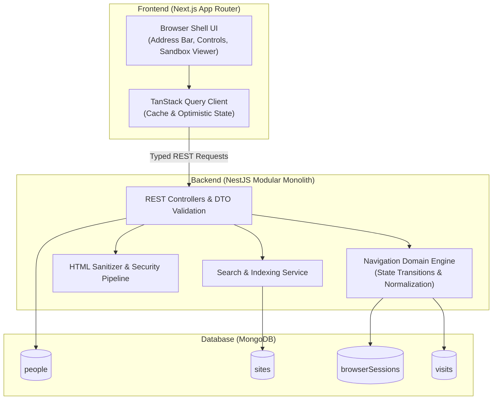

# Wyxan Browser 🌐

[](https://nextjs.org/)
[](https://nestjs.com/)
[](https://www.mongodb.com/)
[](https://www.typescriptlang.org/)
[](https://tailwindcss.com/)

> A database-backed, full-stack web browser system built with **Next.js**, **NestJS**, **MongoDB**, and **TypeScript**. Features explicit navigation state machines, sandboxed isolated HTML rendering, per-person persistent browsing history, full-content search, and self-publishing capabilities.

---

## 📑 Table of Contents

- [Overview](#overview)
- [Key Features](#key-features)
- [System Architecture](#system-architecture)
- [Core Navigation State Machine](#core-navigation-state-machine)
- [Security Model & HTML Isolation](#security-model--html-isolation)
- [Data Model & Persistence](#data-model--persistence)
- [API Contracts](#api-contracts)
- [Project Structure](#project-structure)
- [Getting Started](#getting-started)
- [Testing Strategy](#testing-strategy)
- [License](#license)

---

## 🎯 Overview

**Wyxan Browser** is an engineered full-stack browser simulation built as a clean modular monolith. Rather than mimicking a bloated modern browser engine, it implements rigorous browser primitives correctly:

- **Single Source of Truth:** Persisted navigation state lives exclusively on the backend; the frontend acts as an authoritative thin client.
- **Explicit Navigation Transitions:** Back, Forward, history jumps, and path branching are governed by a deterministic domain engine.
- **Zero In-Memory Discrepancies:** Per-person sessions retain navigation entries while maintaining an immutable, append-only visit history.
- **Strict Content Isolation:** User-published HTML is treated as untrusted and rendered within a fortified, sandboxed iframe environment.

---

## ✨ Key Features

- **Omnibox & Address Bar:** Address input with automatic normalization (`.zz` canonical address resolution, e.g., `Tidepool.ZZ` → `tidepool.zz`).
- **Deterministic Back & Forward Engine:**
  - Branch navigation support: navigating after a backward traverse cleanly truncates the forward path while preserving historical visit logs.
  - Safe edge-case handling: back/forward on boundaries are verified no-ops.
  - Seamless scroll position restoration for returned pages.
- **Multi-Persona Profiles:** Instant profile switching where each person has isolated active sessions and independent persistent visit timelines.
- **Full-Text Content Search:** Instant indexing of both page titles and extracted plain-text body content with search query restoration on history rewind.
- **In-Browser Web Publisher:** Form validation and publishing engine to author new `.zz` internal sites with automated plain-text extraction and sanitization.
- **404 Handling:** Deterministic "Not Found" state integrated into the navigation stack, ensuring Back navigates to the prior valid page.

---

## 🏗️ System Architecture



---

## 🔄 Core Navigation State Machine

All navigation requests pass through a single, pure domain navigation service:

| Action | Behavior | Forward Path | Visit Record |
| :--- | :--- | :--- | :--- |
| **Direct Navigation / Link** | Resolve address, truncate forward path, append entry, update `currentIndex` | Truncated | Appended |
| **Back Button** | Shift `currentIndex` left by 1 (if `currentIndex > 0`) | Preserved | Preserved (Immutable) |
| **Forward Button** | Shift `currentIndex` right by 1 (if `currentIndex < length - 1`) | Preserved | Preserved |
| **Branching Navigation** | From `A -> B -> C -> D`, Back x2 to `B`, navigate to `E` → Active path: `A -> B -> E` | Truncated | `C` & `D` preserved in history |
| **Not Found (404)** | Append not-found entry; Back returns to previous destination | Recorded | Appended |

---

## 🛡️ Security Model & HTML Isolation

User-published content is untrusted by default. The system enforces a **defense-in-depth** pipeline:

1. **Input Validation:** Strict payload size limits and address regex verification (`^[a-z0-9-]+\.zz$`).
2. **HTML Sanitization:** Strict allowlist tag parser discarding `<script>`, inline event handlers (`onload`, `onclick`), external CSS/fonts, and malicious protocols (`javascript:`, `data:`).
3. **Restricted Sandboxed Iframe:** Pages render in `<iframe sandbox="allow-same-origin">` without `allow-scripts` or `allow-top-navigation`, preventing DOM clobbering or parent takeover.
4. **Link Interception:** Clicks within the iframe are parsed to strictly route allowed internal `.zz` addresses back through the backend navigation API.

---

## 🗄️ Data Model & Persistence

| Collection | Key Fields | Purpose |
| :--- | :--- | :--- |
| `people` | `_id`, `name`, `createdAt` | Selectable browsing profiles. |
| `sites` | `_id`, `address`, `title`, `html`, `searchableText`, `authorId`, `timestamps` | Published internal `.zz` web pages with text indexing. |
| `browserSessions` | `_id`, `personId`, `entries[]`, `currentIndex`, `version`, `updatedAt` | Active navigable stack and current pointer per person. |
| `visits` | `_id`, `personId`, `address`, `siteId`, `transition`, `visitedAt` | Append-only chronological navigation ledger. |

---

## 🔌 API Contracts

| Method | Endpoint | Description |
| :--- | :--- | :--- |
| `GET` | `/people` | Retrieve list of selectable personas |
| `GET` | `/sites/:address` | Resolve canonical site by `.zz` address |
| `POST` | `/sites` | Publish a new web page (validates, sanitizes, indexes) |
| `GET` | `/sites/search?q=` | Full-text query against titles and searchable body text |
| `GET` | `/browser/:personId` | Fetch active browser session state |
| `POST` | `/browser/:personId/navigate` | Execute navigation to address or search destination |
| `POST` | `/browser/:personId/back` | Step backward in navigation stack |
| `POST` | `/browser/:personId/forward` | Step forward in navigation stack |
| `POST` | `/browser/:personId/history/:entryId` | Direct jump to a prior history entry |
| `GET` | `/browser/:personId/history` | Chronological list of user visit records |

---

## 📂 Project Structure

```text
wyxan-browser/
├── frontend/                     # Next.js App Router Frontend
│   ├── src/
│   │   ├── app/                  # Application routes and layouts
│   │   ├── features/
│   │   │   ├── browser/          # Address bar, controls, iframe viewport
│   │   │   ├── history/          # Per-person visit drawer & timeline
│   │   │   ├── search/           # Full-content search bar & result cards
│   │   │   └── publisher/        # Site publication form & validation
│   │   └── lib/                  # API client, types, and utilities
│   ├── package.json
│   └── tailwind.config.ts
├── backend/                      # NestJS Modular Backend
│   ├── src/
│   │   ├── modules/
│   │   │   ├── navigation/       # Pure state machine & session management
│   │   │   ├── sites/            # Site resolution, sanitization & publishing
│   │   │   ├── search/           # Text search & query services
│   │   │   ├── people/           # Persona profiles
│   │   │   └── seed/             # Deterministic & idempotent seed runner
│   │   └── main.ts
│   ├── package.json
│   └── tsconfig.json
├── docs/                         # Architecture, schemas, and specifications
├── docker-compose.yml            # Local MongoDB container setup
└── README.md
```

---

## 🚀 Getting Started

### Prerequisites

- **Node.js:** `v18.x` or `v20.x`
- **Package Manager:** `npm` or `pnpm`
- **Database:** Local MongoDB instance or Docker

### 1. Clone the Repository
```bash
git clone https://github.com/badarfaisal01/wyxan-browser.git
cd wyxan-browser
```

### 2. Start Database
```bash
docker compose up -d
```

### 3. Backend Setup (NestJS)
```bash
cd backend
npm install
npm run seed     # Populate deterministic test data & personas
npm run start:dev
```
Backend runs on `http://localhost:3001` (Swagger API docs at `http://localhost:3001/api`).

### 4. Frontend Setup (Next.js)
```bash
cd ../frontend
npm install
npm run dev
```
Open `http://localhost:3000` in your browser.

---

## 🧪 Testing Strategy

The repository follows a test-driven approach covering domain mechanics, database integrity, and end-to-end browser workflows:

- **Unit Tests:** Pure navigation state logic (`navigate`, `back`, `forward`, truncation, edge boundary checks).
- **Integration Tests:** REST endpoints, session persistence, optimistic concurrency control, and sanitization defense.
- **E2E Tests (Playwright):** Complete user journeys including 4-link traversals, Back/Forward verification, search query return, and broken-address recovery.

```bash
# Run unit & integration tests
npm run test

# Run Playwright E2E journeys
npm run test:e2e
```

---

## 📄 License

This project is licensed under the [MIT License](LICENSE).

